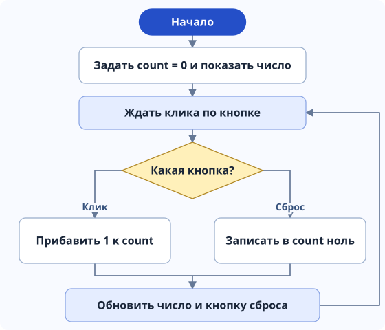
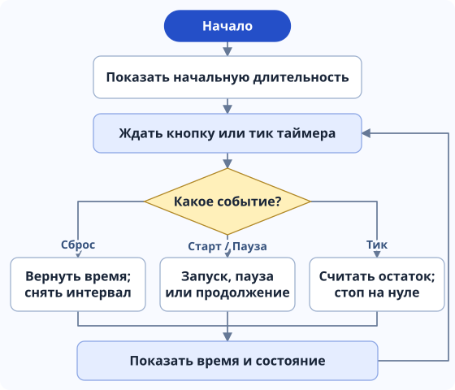
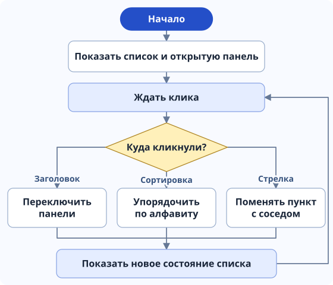
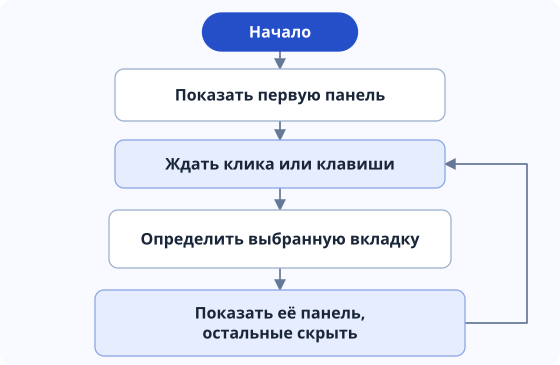
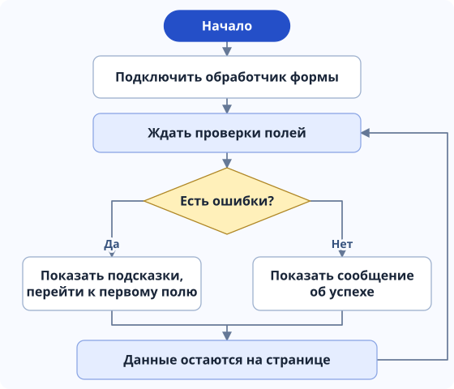
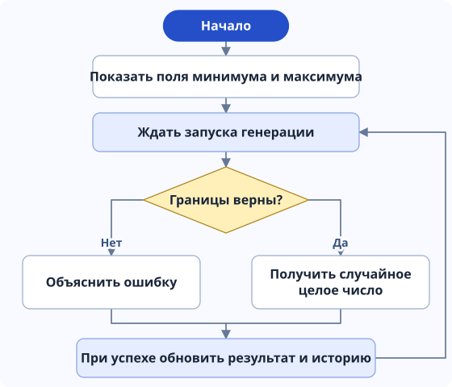
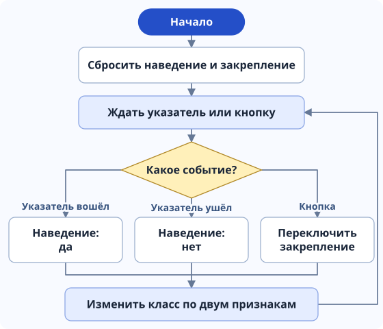
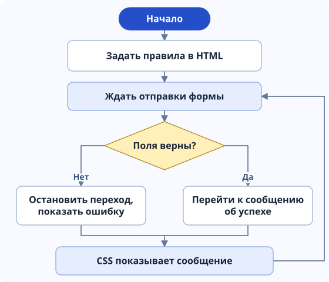

# Алгоритмы и блок-схемы

Семь компонентов варианта и отдельная форма на HTML и CSS.

## 01. Счётчик кликов

1. При загрузке создаём переменную `count` со значением 0. В HTML сначала показан ноль.
2. При клике «+1 Клик» увеличиваем `count` на единицу. При сбросе записываем 0.
3. Выводим значение через `textContent`. Пока значение равно нулю, кнопка сброса недоступна.

## 03. Таймер обратного отсчёта

1. Читаем длительность: целое число от 1 до 3599 секунд. Переводим его в миллисекунды. При неверном вводе показываем ошибку.
2. При запуске запоминаем момент окончания: `performance.now() + remaining`. Включаем `setInterval`.
3. На каждом тике вычитаем текущее время из времени окончания. Показываем остаток в формате ММ:СС и заполняем шкалу. На нуле останавливаем интервал.
4. Пауза запоминает остаток и останавливает интервал. Продолжение вычисляет новый момент окончания. Сброс возвращает последнюю корректную длительность.

## 05. Аккордеон

1. У каждого заголовка есть панель. При клике закрываем остальные панели и открываем выбранную. Повторный клик закрывает её.
2. Кнопки «А → Я» и «Я → А» сортируют массив строк по их названиям с помощью `sort()` и `Intl.Collator("ru")`.
3. Кнопки ↑ и ↓ меняют пункт местами с соседом. Перемещаем существующие элементы DOM, поэтому открытая панель остаётся открытой.
4. После перестановки блокируем ↑ у первого пункта и ↓ у последнего.

## 08. Вкладки

1. При загрузке видна первая панель. Каждая кнопка связана с панелью через `aria-controls`.
2. При клике или нажатии стрелки, Home или End определяем, какую вкладку выбрать.
3. У выбранной вкладки ставим `aria-selected="true"` и показываем её панель. Остальные панели скрываем через `hidden`. При управлении с клавиатуры переносим фокус.

## 09. Форма с проверкой на JavaScript

1. Перехватываем `submit` и отменяем отправку через `event.preventDefault()`.
2. Проверяем имя, почту и группу: длину и нужный формат. Для шаблонов используем регулярные выражения и `test()`.
3. Если есть ошибки, показываем их рядом с полями и переводим фокус на первое неверное поле. После первой проверки подсказки обновляются при вводе.
4. Если ошибок нет, выводим сообщение об успехе. Данные остаются на странице.

## 14. Генератор случайных чисел

1. Читаем минимум и максимум. Проверяем, что оба числа целые, от −1 000 000 до 1 000 000, а минимум не больше максимума.
2. Если границы неверны, показываем подсказку. Иначе берём `Math.random()` — число от 0 включительно до 1 невключительно.
3. Умножаем на количество возможных целых чисел, округляем вниз и прибавляем минимум: `Math.floor(Math.random() * (max - min + 1)) + min`.
4. Показываем число и добавляем его в историю из пяти последних результатов. Обе границы могут выпасть.

## 20. Анимация при наведении

1. На `pointerenter` запоминаем, что указатель над площадкой; на `pointerleave` и `pointercancel` сбрасываем этот признак. Касание пальцем не считаем наведением.
2. Кнопка отдельно переключает закрепление эффекта. Она работает с клавиатуры и на телефоне.
3. Если есть наведение или закрепление, добавляем класс `is-active`. Иначе убираем его.
4. CSS плавно меняет положение, наклон и размер фигуры. При настройке уменьшенного движения переходы отключаются.

## 09+. Дополнение: проверка без JavaScript

1. В HTML задаём обязательность, длину и формат через `required`, `minlength`, `maxlength`, `pattern` и `type="email"`.
2. При нажатии «Проверить» браузер сам проверяет поля. Для ошибки используется встроенная подсказка браузера; CSS `:user-invalid` показывает текст рядом с полем.
3. При успешной проверке открывается фрагмент `#native-success`, а CSS `:target` показывает сообщение. У полей нет `name`, их значения не попадают в адрес.

